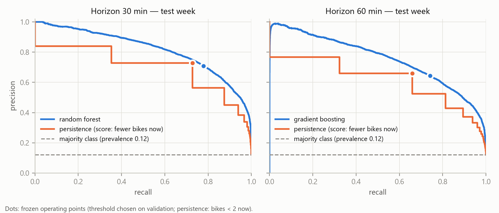
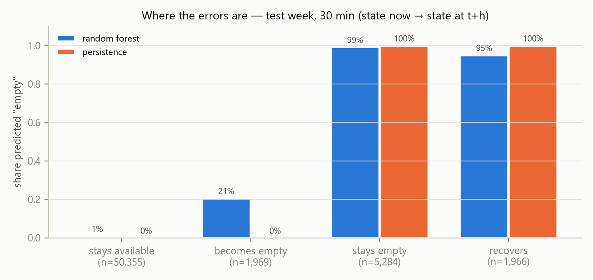

# 1. Question

A Vélib' station with fewer than two bikes makes a departure practically impossible. The current state of a station is
public, but a user needs to know what it will be when they arrive. We therefore ask:

> **For each of the 80 stations, will the station have fewer than 2 bikes available 30 minutes (respectively 60
> minutes) from now?**

* **Target.** $y(s,t) = \mathbb{1}\{\text{bikes\_available}(s, t+h) < 2\}$, with $h \in \{30, 60\}$ minutes, on a 15-minute
  grid.
* **Population.** All 80 stations, one common model.
* **References.** The majority class, and **persistence**: $\hat y(s,t) = \mathbb{1}\{\text{bikes\_available}(s,t) < 2\}$.
* **Why not 15 minutes.** At 15 minutes, persistence is almost unbeatable, so 30 minutes is the shortest horizon where
  anticipation is meaningful.

The model predicts an *observed state of the service* as published by the feed. It is not a model of users' demand.

# 2. Data

The frozen file (329,680 rows, md5 `02ab1e3fdac10579e4ce93d1540a5dc7`) holds one snapshot per station roughly every
15 minutes, from 25 August to 8 October 2026, for 80 stations (50 in Paris, 30 in the suburbs). Timestamps are in UTC;
every calendar feature is computed in Paris local time (UTC+2 over the whole period).

**Quality.** Problems are described rather than hidden (Table 1).

| Issue | Extent | Treatment |
|---|---|---|
| Collection outage | one 28 h gap (23 Sep 09:45 → 24 Sep 13:45 UTC) and nine 30-min gaps | slots left empty; the outage separates train and validation |
| Incomplete snapshots | 36 snapshots: always the same 30 stations or the complementary 50 (both sets mix Paris and suburbs) | unobserved slots, never filled |
| Closed stations (`is_renting = 0`) | 4 stations, 812 rows, episodes of 1–2 days; a closed station reports ~0 bikes | excluded from the population and from lag sources; sensitivity analysis |
| Missing capacity | 26 snapshots | capacity is constant per station, so filling it is not a look-ahead |
| bikes + docks > capacity | 2,256 rows, 73 % from station 45504 | fill ratio = bikes / (bikes + docks) |
| Possibly frozen station | 45504 is unchanged in 89 % of consecutive snapshots (median station: 38 %) | kept, described; results unchanged without it |
| `source_updated_at` | lags the collection by ~1 h and often does not move when the bike count does | not used |

*Table 1 — Data quality.*

**Target.** On the training weeks, 10.3 % of samples are positive at 30 minutes. The share of slots with fewer than 2
bikes rises from about 8 % at night to about 12–13 % during the day (Paris time). It is 11.8 % for Paris stations and
7.8 % for suburban stations. It varies widely between stations: the median is 5.8 % and the maximum 46 %. The rate also
drifts upward week after week: 8.6 % in the last week of the summer holidays, 13 % at the end of September. This
non-stationarity matters for the protocol.

# 3. Protocol

**Chronological split.**

| Block | Period (UTC) | Samples (30 min) | Role |
|---|---|---|---|
| Train | 25 Aug → 23 Sep (up to the outage) | 219,127 | fitting |
| Validation | 24 Sep 13:45 → 1 Oct 00:00 Paris time | 47,612 | hyper-parameters, thresholds, model choice |
| Test | 1 Oct → 8 Oct | 59,574 | scored once, after the choices are frozen |

A sample is kept only if the station is observed and open at $t$ and at $t+h$, and if $t+h$ lies in the same block as $t$.
Every excluded slot is counted by reason and by block. For example, 160 samples are dropped at 30 minutes because their
label would fall in the next block.

**Features available at time $t$.**
* **Current state:** bikes, docks, fill ratio.
* **Recent trends:** changes over 15, 30 and 60 minutes, and the count 24 hours earlier. These are per-station shifts on
  a regular grid, read from open slots only, so a gap or a closure yields a missing value, never an interpolated one.
* **Calendar (Paris time):** cyclic hour of day, day of week, weekend.
* **Station attributes:** capacity, Paris/suburb, coordinates, and the station's empty rate measured on the training
  block only.

**Leakage guards.** These rules are enforced by 16 automated tests.
* No random split anywhere.
* Every imputer and scaler sits inside a pipeline fitted on train.
* The station rate is a single training-period constant. A leave-one-week-out version was tried and rejected: through
  the station's coordinates it lets trees recover each row's own-week labels.
* The test block's labels, including its positive rate, are not inspected before the choices are frozen.

**Models and selection.**
* **Families:** naive Bayes, k-NN, k-NN weighted by feature importances (estimated inside train with a purged
  hold-out), a decision tree, a random forest and gradient boosting.
* **Tuning on validation:** the number of neighbours $k$ and the tree depth maximise validation PR-AUC. Each model's
  decision threshold maximises validation F1. The final model is the one with the best validation PR-AUC, a rule fixed
  in advance.
* **Disclosure:** during an audit of a first version of this project, that version's frozen models were also scored on
  the test week. The selection rule and the hyper-parameter grids are unchanged. All later changes follow from the
  brief's rules or from train/validation evidence.

**Metrics.** Positives are rare (≈ 12 %), so accuracy is not reported: always predicting "available" already scores
88 %. We report:
* PR-AUC, and precision, recall and F1 at the frozen threshold;
* results by group and by day;
* 95 % intervals obtained by resampling the 80 stations, because rows of one station are strongly dependent.

# 4. Results

| Model | PR-AUC 30 min | F1 30 min | PR-AUC 60 min | F1 60 min |
|---|---|---|---|---|
| Majority class | 0.122 | 0 | 0.122 | 0 |
| Persistence | 0.702 | 0.729 | 0.619 | 0.660 |
| Naive Bayes | 0.629 | 0.634 | 0.561 | 0.569 |
| k-NN (k = 50) | 0.699 | 0.642 | 0.662 | 0.619 |
| Weighted k-NN | 0.799 | 0.736 | 0.730 | 0.677 |
| Decision tree (depth 8) | 0.801 | 0.738 | 0.722 | 0.672 |
| **Random forest** (chosen at 30 min) | **0.816** | **0.742** | 0.747 | 0.685 |
| **Gradient boosting** (chosen at 60 min) | 0.812 | 0.744 | **0.754** | **0.689** |

*Table 2 — Test week, all models frozen after validation. Persistence's PR-AUC uses a graded score (fewer bikes now =
higher risk); with its binary rule alone it would be 0.56 / 0.48, so the comparison is generous to the reference.*

**Versus persistence.**

| | 30 min | 60 min |
|---|---|---|
| Gain in PR-AUC [95 % interval] | +0.114 [0.101; 0.128] | +0.134 [0.118; 0.150] |
| Gain in F1 [95 % interval] | +0.013 [0.007; 0.020] | +0.030 [0.019; 0.040] |
| Precision at persistence's recall (persistence → model) | 0.729 → 0.749 | 0.660 → 0.700 |

The gain is therefore large in **ranking** (PR-AUC) and modest at a single operating point. It is larger at 60 minutes,
where persistence degrades faster. The random forest and gradient boosting are statistically tied: across five seeds,
gradient boosting's validation PR-AUC varies by ±0.008, more than the gap between the two.

**Stability.** Day by day, the random forest's F1 is 0.741 ± 0.032, against 0.728 ± 0.031 for persistence. The
lowest day is Sunday 4 October for both. Paris and suburban stations reach similar scores (PR-AUC 0.82 vs 0.81).
Weekends are harder than weekdays (0.78 vs 0.83).

**Robustness.**
* Counting a closure at $t+h$ as "departure impossible" adds 5 / 8 test samples and changes no metric at three decimals.
* Removing station 45504 changes nothing (it has no positive).

# 5. Errors and features

**Where the gain comes from.** Persistence is right by construction whenever the state does not change, which covers
93 % of the test samples at 30 minutes. Splitting the samples by situation shows where the model differs:
* It anticipates **21 %** of the stations that *become* empty within 30 minutes (32 % at 60 minutes). Persistence
  catches none of them.
* It still predicts "empty" for 95 % of the empty stations that are about to *recover* (persistence: 100 %).

Refills are thus hardly anticipated from a station's own history.

**When.**
* Nights are easy (PR-AUC 0.92) and bring no gain over persistence.
* The morning and the day bring the clearest gains in recall.
* The evening peak (17–20 h, Paris time) is the hardest period for both (PR-AUC 0.69 vs 0.58).
* Per station, the model's F1 is at least that of persistence on 68 % of the stations that have a positive in the test
  week. The losses concern stations with very few positives.

**Contribution of the features.** A random forest is refitted on validation without each group of features; this
estimator is stable across seeds.

| Configuration | Δ PR-AUC 30 min | Δ PR-AUC 60 min |
|---|---|---|
| without current state | −0.268 | −0.213 |
| without calendar (Paris time) | −0.021 | −0.044 |
| without station attributes | −0.008 | −0.015 |
| without recent trends | −0.010 | −0.001 |
| current state only (3 features) | −0.071 | −0.088 |

*Table 3 — Validation PR-AUC lost when a group of features is removed (reference: 0.828 / 0.766).*

The current state carries most of the information. Even the three state features alone rank better than persistence
(0.757 vs 0.707 at 30 minutes), because the fill ratio and the number of free docks refine the ordering. The hour of day
matters more at 60 minutes. Recent trends are largely redundant once the current state is known. Permutation importance
would overstate single features here: the bike count and the fill ratio are correlated (r = 0.80), and refitting without
the bike count alone costs only 0.013. These are associations measured on this period, not effects.

# 6. Limits

**Collection.**
* Six weeks, 80 stations, a single season (late summer to early autumn 2026).
* The 28-hour outage just before validation leaves the 24-hour lag missing on 17 % of validation rows.
* 36 incomplete snapshots; four temporary closures; one possibly frozen station; a source timestamp that cannot be
  trusted as a freshness signal.
* A positive rate drifting upward over the period.
* No weather, events or rebalancing data.

**Use.**
* The model reproduces the counts published by the feed. It cannot distinguish departures from missing rebalancing or
  data errors, and it says nothing about individual users' behaviour.
* Its thresholds were chosen for F1. A real service would set them from the relative cost of a missed emptying and of
  a false alarm.
* Any use on other stations, another season or another year requires a new evaluation.

# 7. Conclusion

Thirty and sixty minutes ahead, a common tree-ensemble model identifies stations at risk of having fewer than two bikes
clearly better than persistence in ranking (PR-AUC +0.11 and +0.13, with intervals well away from zero). At a single
operating point the gain is modest (F1 +0.01 and +0.03). This gain comes almost entirely from anticipating stations
that are about to empty, a situation persistence cannot detect by construction. Refills remain hard to foresee from the
feed alone. A simple model on the current state already captures most of the signal; the hour of day adds a little.
These conclusions hold for the 80 stations and the six weeks observed. They describe the service as published by the
feed, not users' demand.

---

**Reproducibility.** Code, tests and commands: see the repository README (`python scripts/run_pipeline.py --extras`
regenerates every number and figure in 10–15 minutes). Data: Vélib' Métropole — real-time availability, Paris Data,
Open Database License (ODbL).
